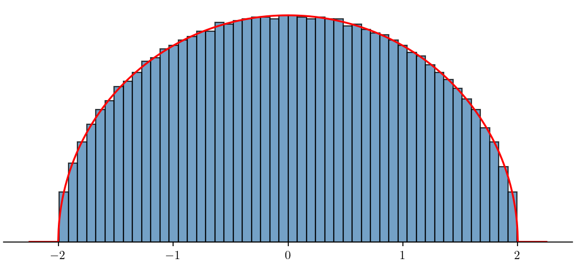

# Home {.unnumbered}

This project is an expository introduction to random matrix theory: an incredibly interesting area of mathematics I learned about for my MSc dissertation! The theory here is intended to be accessible and largely supported by numerical examples in Python. For a more complete treamet, refer to the primary references [@mehta2004random; @forrester2010log; @anderson2010introduction; @livan2018introduction; @tao2012topics].

There is a similar [exposition by Robert Sweeney Blanco](https://robertsweeneyblanco.github.io/Computational_Random_Matrix_Theory/Home/Home.html) that was indeed the inspiration for this site. Their work is excellent and recommended as another resource. This project is different in that it puts far more focus on the application of Dyson Brownian Motion for random matrices.

<!-- images -->
{#fig:eigenvalues_gue width=100%}